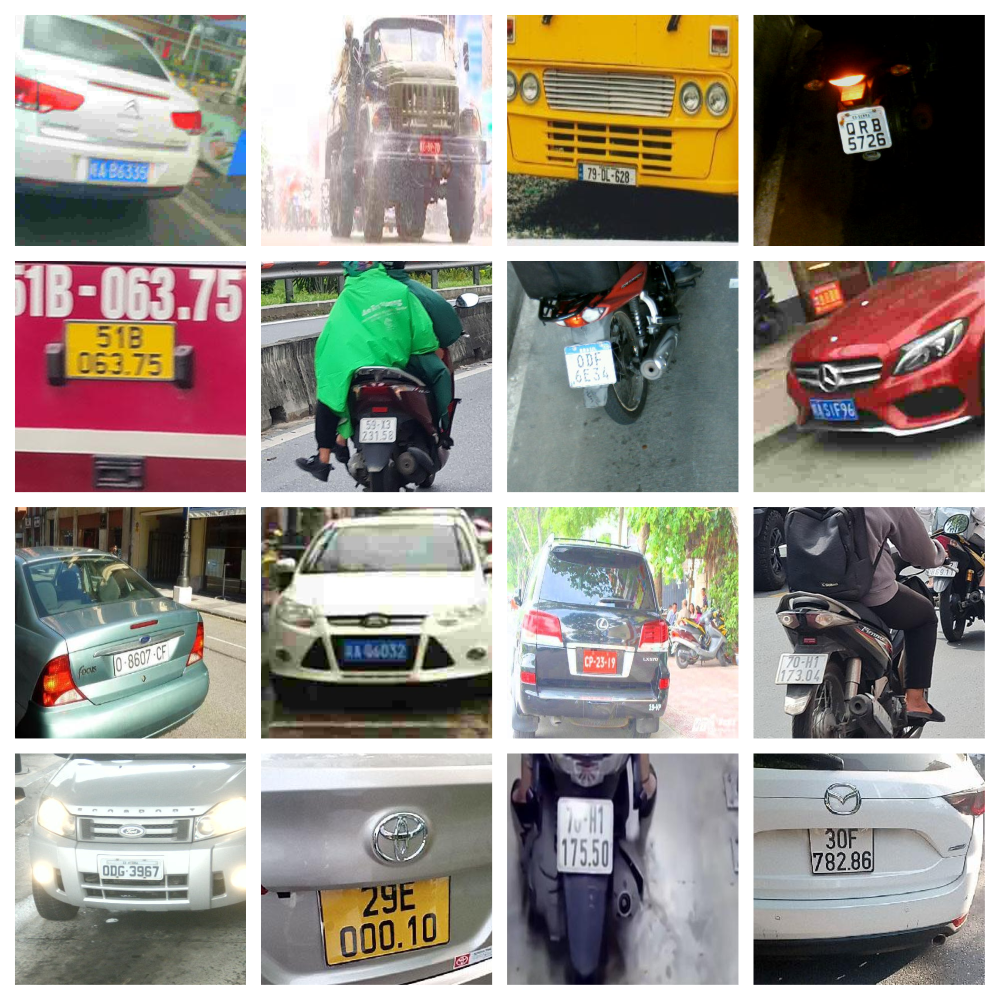

# LiteALPR: Lightweight & Accurate License Plate Recognition

[](https://pypi.org/project/litealpr/)
[](https://pypi.org/project/litealpr/)
[](https://www.gnu.org/licenses/agpl-3.0)
[](https://doi.org/10.5281/zenodo.22722292)

<p align="center">
  
  <br>
  <em>Representative license plate samples across diverse layouts and visual conditions evaluated in LiteALPR.</em>
</p>

## What is LiteALPR?

**LiteALPR** is an open-source, lightweight two-stage Automatic License Plate Recognition (ALPR) library designed for high-throughput workstation processing and resource-constrained edge deployment.

LiteALPR integrates two task-specific lightweight adaptations:

1. **YOLOv8n-Efficient Detector**: Replaces dense C2f bottlenecks across backbone stages (P3–P5) and the PANet neck with lightweight C3Ghost modules ($5 \times 5$ depthwise convolutions), reducing parameters to **2.00M**, cutting $416 \times 416$ compute to **2.36 GFLOPs** (-30.8%), and accelerating CPU detection by **2.34×** while preserving localization precision (**99.45% $\text{mAP}_{50}$**, **88.07% $\text{mAP}_{50-95}$**).
2. **SVTR26-Tiny Recognizer**: Replaces 2D self- and cross-attention decoders with an attention-free **Efficient RCTC Decoder** using **Height-wise Average Pooling (HAP)** and 4-bucket aspect-ratio resizing ($64 \times 64$, $48 \times 96$, $40 \times 112$, $32 \times 128$), reducing parameters to **4.22M** and lowering latency to **~5.03 ms** on GPU and **~8.32 ms** on CPU.
3. **Multi-National Training & Degradation Modeling**: Trained with Gaussian/motion blur, JPEG compression, additive noise, and PARSeq-style augmentations across Brazilian, Chinese, and Vietnamese/auxiliary benchmarks.

## Key Highlights

- ⚡ **High Throughput**: **66.45 FPS** on an NVIDIA GeForce RTX 3060 GPU, **23.44 FPS** on an AMD Ryzen 5 4600G CPU, and **15.70 FPS (10W) / 10.74 FPS (5W)** sustained without thermal throttling on an NVIDIA Jetson Nano (4GB).
- 🎯 **Competitive Accuracy**: **77.55% end-to-end exact-match accuracy (6.22% CER)** on 5,230 full-scene holdout images (compared to 39.67% for out-of-the-box [fast-alpr](https://github.com/ankandrew/fast-alpr)), and **89.14% sequence accuracy (3.28% CER)** across 25,000 localized plate crops (**87.96%** on the 22,350 real-image crops; **89.25%** on 20,036 strictly unseen-plate crops).
- 📦 **Plug-and-Play Python API**: Simple `LiteALPR()` interface with automatic Hugging Face weight caching and modular `detect()` / `recognize()` execution.
- 🔄 **Flexible Backends**: Native support for **ONNX Runtime** (CPU & CUDA), **PyTorch** (`.pt` / `.pth`), and **TensorRT** 4-profile static engines on Jetson Nano.
- 🌐 **Multi-National Benchmarks**: Evaluated across [Brazil (RodoSol-ALPR)](https://github.com/raysonlaroca/rodosol-alpr-dataset), [China (CCPD)](https://github.com/detectRecog/CCPD) & [CBLPRD-330k](https://github.com/SunlifeV/CBLPRD-330k), [Vietnam](https://www.kaggle.com/datasets/duydieunguyen/licenseplates), and [Auxiliary European](https://www.kaggle.com/datasets/abdelhamidzakaria/european-license-plates-dataset) subsets, with full sample-level split manifests in `manifests/`.

## Quick Example

```python
from litealpr import LiteALPR

# Initialize pipeline (auto-downloads pre-trained models from HuggingFace)
model = LiteALPR()

# Read license plate
results = model.read("sample.jpg")

for res in results:
    print(f"Plate: {res['text']} | Confidence: {res['score']:.4f} | Box: {res['box']}")
```

## Next Steps

- Check out [Getting Started](getting-started.md) to install LiteALPR via `pip`.
- Read about our [Pipeline & Architecture](pipeline.md) design.
- Explore the comprehensive [Python API & Usage](usage.md) guide.
- Learn how to train custom models in the [Training & Tools](training.md) guide.
- Understand the hardware and software setup in [Reference Environment](reference-environment.md).
- Review detailed [Benchmarks](benchmarks.md) across GPU, CPU, and regional subsets.
- Learn how to build 4-profile TensorRT engines in [Jetson Nano Deployment](jetson-nano.md).
- Cite the project in your research using [Paper & Citation](citation.md).
