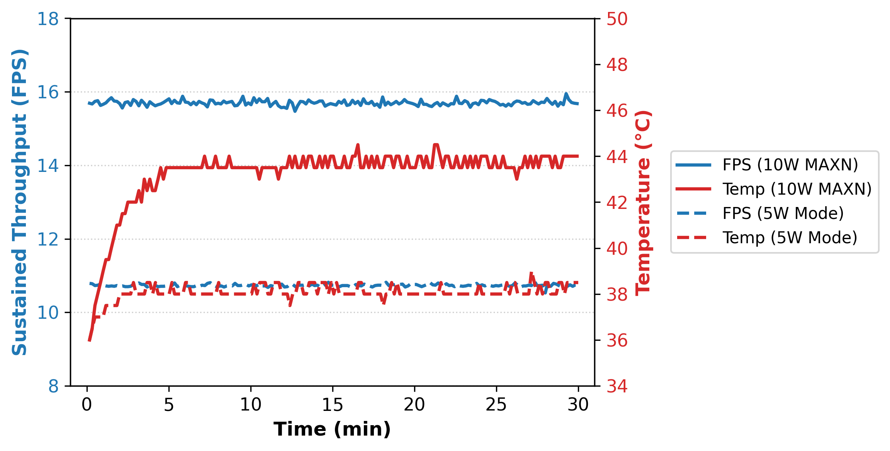

# Edge Deployment (Jetson Nano)

To demonstrate the viability of LiteALPR on resource-constrained edge hardware, we deployed and profiled the pipeline on an embedded NVIDIA Jetson Nano (4GB) using TensorRT 8.2.1.

## Hardware & Software Specifications

- **Hardware**: NVIDIA Jetson Nano Developer Kit (4GB)
    - **CPU**: Quad-core ARM Cortex-A57
    - **GPU**: 128-core NVIDIA Maxwell (GM20B)
    - **Memory**: 4 GB 64-bit LPDDR4 (25.6 GB/s bandwidth)
    - **Configured Power Modes**: 10W MAXN (`nvpmodel -m 0`) and 5W (`nvpmodel -m 1`)
- **Software Environment**:
    - **OS**: Ubuntu 18.04 (JetPack 4.6.1)
    - **CUDA / cuDNN**: CUDA 10.2 / cuDNN 8.2
    - **TensorRT**: 8.2.1
    - **Python**: 3.6.9

## Step 1: Export Models to ONNX

Export the trained PyTorch models to ONNX on your host workstation:

```bash
# Export Detection Model (416x416)
python tools/export_det.py \
    -m output/det/yolov8n_efficient/train/weights/best.pt \
    --imgsz 416 \
    --opset 12

# Export Recognition Model (dynamic input shapes)
python tools/export_rec.py \
    -m output/rec/svtr26_tiny/train/best.pth \
    --save_path output/rec/svtr26_tiny/train/best.onnx \
    --opset 12 \
    --dynamic
```

## Step 2: Calibrate INT8 & Build 4-Profile TensorRT Engines

Because TensorRT 8.2.1 exhibits numerical divergence when compiling multi-aspect-ratio transformers under a single dynamic profile, `SVTR26-Tiny` is compiled with **four static optimization profiles** matching its discrete aspect-ratio buckets (`64×64`, `48×96`, `40×112`, and `32×128`). INT8 Post-Training Quantization (PTQ) uses `IInt8EntropyCalibrator2` calibrated on 500 validation crops strictly disjoint from the 25,000-crop test set.

```bash
# 1. Build YOLOv8n-Efficient Detector Engine (FP16 at 416x416)
/usr/src/tensorrt/bin/trtexec --onnx=pretrained_models/det/yolov8n_efficient/best_416.onnx \
    --saveEngine=yolov8n_efficient_416_fp16.engine \
    --fp16 \
    --workspace=1024

# 2. Generate INT8 Entropy Calibration Cache (500 validation crops)
python test_performance/build_int8_calib.py \
    --onnx pretrained_models/rec/svtr26_tiny/best.onnx \
    --calib-out svtr26_tiny.calib \
    --labels-file dataset/rec/val_labels.txt \
    --dataset-dir dataset/rec \
    --num-images 500

# 3. Compile 4-Profile Static Recognizer Engines (FP32, FP16, and INT8)
python test_performance/build_trt_4profiles.py \
    --onnx pretrained_models/rec/svtr26_tiny/best.onnx \
    --calib svtr26_tiny.calib \
    --precision all \
    --output-dir .
```

## Step 3: Standalone Latency & Precision Trade-offs

Pure GPU inference latency was measured in 10W MAXN mode (`nvpmodel -m 0`) over 1,000 iterations (with 100 warm-up runs). At $416 \times 416$, **YOLOv8n-Efficient (FP16)** achieves **20.66 ms** detection latency. Across the full 25,000-crop test set, **SVTR26-Tiny** precision trade-offs (latency measured at $32 \times 128$) are:

| Precision | Engine Size | Pure GPU Latency (ms) | Test Accuracy (%) | Test CER (%) |
| :--- | :---: | :---: | :---: | :---: |
| **FP32** | 141 MB | 23.05 | 89.14 | 3.28 |
| **FP16** | 129 MB | 23.50 | 89.14 | 3.28 |
| **INT8 (PTQ)** | **44 MB** | 27.06 | 89.12 | 3.29 |

> **Hardware Note:** Both FP32 and FP16 TensorRT engines match the workstation PyTorch accuracy (89.14%). Because the Jetson Nano's Maxwell GPU (GM20B) lacks native INT8 Tensor Cores, INT8 PTQ introduces a ~4 ms reformatting overhead rather than a speedup, but shrinks serialized engine size by **3.2×** (44 MB vs. 141 MB) with only a 0.02% accuracy difference (4 crops out of 25,000).

## Step 4: System Resource Monitoring (`tegrastats`)

Short-run (~1 min) system resource utilization in 10W MAXN mode monitored via `tegrastats` confirms that the complete pipeline peaks at **2.55 GB RAM**, safely within the 4 GB limit:

| Execution Phase | RAM Utilization | CPU Utilization | GPU Utilization | Temperature |
| :--- | :---: | :---: | :---: | :---: |
| Idle | 1,467 MB | ~3% | 0% | 25.0°C |
| Initialization | 1,742 MB | ~26% | 99% | 25.0°C |
| Peak Inference | 2,554 MB | ~35% | 40–99% | 32.0°C |
| Cooldown | 1,467 MB | ~22% | 0% | 30.5°C |

*(Initialization exhibits a brief 99% GPU spike during TensorRT engine deserialization before thermal inertia raises die temperature above 25.0°C.)*

## Step 5: 30-Minute Always-On Thermal & Power Stress Testing

To validate sustained stability under continuous operation, run the Always-On stress test combining `YOLOv8n-Efficient` (FP16) and the 4-profile `SVTR26-Tiny` (INT8, 44 MB) engine:

```bash
python test_performance/run_stress_test_jetson_nano.py \
  --images_dir /path/to/your/dataset/images \
  --det_model_path yolov8n_efficient_416_fp16.engine \
  --rec_model_path svtr26_tiny_int8.engine \
  --dict_path litealpr/license_plate_dict.txt \
  --duration 30 \
  --output_csv run_stress_test_results.csv
```

Across continuous 30-minute runs, the pipeline sustains **15.70 ± 0.07 FPS** under **10W MAXN** mode (`nvpmodel -m 0`, reaching a steady peak of **44.5°C**) and **10.74 ± 0.03 FPS** under **5W** mode (`nvpmodel -m 1`, reaching a steady peak of **39.0°C**), with zero thermal throttling.


