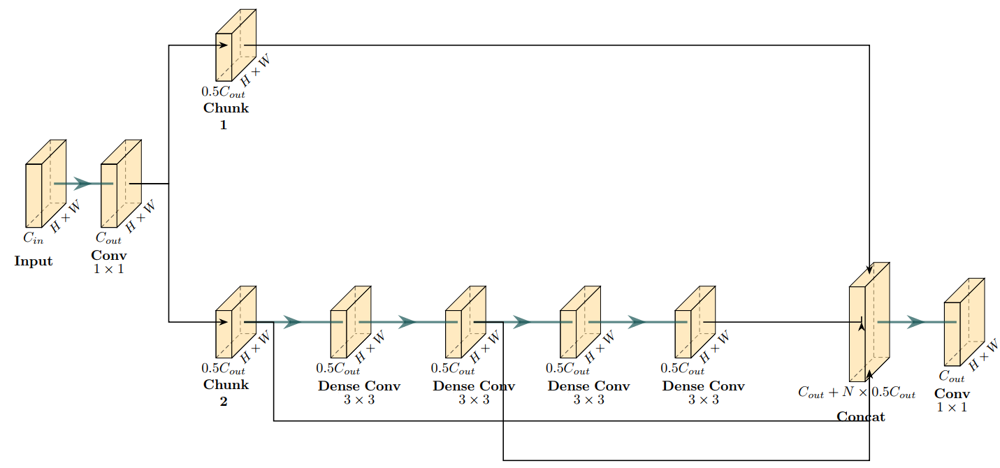
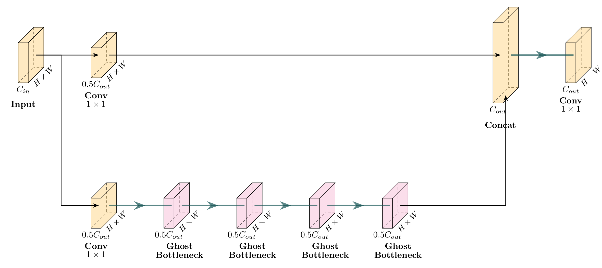
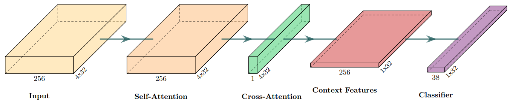
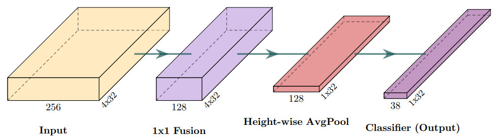

# Pipeline & Architecture

LiteALPR is structured as a modular two-stage sequential pipeline: **Detection** followed by **Recognition**. Both stages are adapted to minimize redundant computations for high-throughput and edge-oriented deployment.

  
  ➔ <b>YOLOv8n-Efficient</b> ➔
  
  ➔ <b>SVTR26-Tiny</b> ➔ <code>59P289136</code>

## 1. YOLOv8n-Efficient for Fast Detection

The first stage localizes license plate bounding boxes from full-scene traffic frames.

### C3Ghost Integration
Standard YOLOv8 architectures rely on multi-layer **C2f** blocks containing dense $3 \times 3$ Bottlenecks across both backbone and neck. LiteALPR replaces C2f blocks across backbone stages (P3, P4, P5) and the PANet neck with lightweight **C3Ghost** blocks based on GhostNet:

1. **Intrinsic Feature Generation**: Given input $X \in \mathbb{R}^{C \times H \times W}$, a primary $1 \times 1$ convolution generates reduced intrinsic feature maps:

    $$Y' = X * W$$

2. **Ghost Feature Generation**: Cheap $5 \times 5$ depthwise convolutions ($\Phi$) synthesize remaining feature maps from each intrinsic channel:

    $$y_{ij} = \Phi_{i,j}(y'_i), \quad \forall i = 1, \dots, m; \quad j = 1, \dots, s$$

3. **Feature Concatenation**: Intrinsic and ghost feature maps are concatenated along the channel dimension:

    $$Y = [Y', Y'']$$

| Baseline: Standard C2f Block | Proposed: Lightweight C3Ghost Block |
| :---: | :---: |
| { width="320" } | { width="320" } |

### Key Improvements (Evaluated at $416 \times 416$ Deployment Resolution)
- Reduces parameters from **3.01M** to **2.00M** (**33.6% reduction**).
- Reduces compute at $416 \times 416$ from **3.41 GFLOPs** to **2.36 GFLOPs** (**30.8% reduction**).
- Latency on NVIDIA RTX 3060: **9.02 ± 0.98 ms** (vs. 10.02 ± 1.29 ms baseline).
- Latency on AMD Ryzen 5 4600G CPU: **17.45 ± 1.62 ms** (vs. 40.92 ± 5.44 ms baseline, **2.34× faster**).
- Preserves localization precision: **99.45% $\text{mAP}_{50}$** and **88.07% $\text{mAP}_{50-95}$** (vs. 99.44% and 88.01% baseline).

## 2. SVTR26-Tiny for Fast Recognition

The second stage transcribes alphanumeric character sequences from cropped license plates (resized dynamically into four aspect-ratio buckets: $64 \times 64$, $48 \times 96$, $40 \times 112$, and $32 \times 128$ using PIL `BICUBIC` interpolation).

### Efficient RCTC Decoder (Height-wise Average Pooling)
General scene-text recognizers rely on heavy 2D multi-head self-attention and cross-attention decoders to handle curved or irregular text. Exploiting the predominantly horizontal geometry of license plates, **SVTR26-Tiny** prunes the 2D attention layers of SVTRv2's RCTC decoder and introduces the **Efficient RCTC Decoder**:

1. **Channel Fusion ($1 \times 1$ Conv)**: Compresses incoming 2D features $X \in \mathbb{R}^{C \times H \times W}$ to $X_{\text{fused}} \in \mathbb{R}^{128 \times H \times W}$.
2. **Height-wise Average Pooling**: Collapses the vertical dimension $H$ without learnable parameters to form a 1D horizontal sequence:

    $$X_{\text{pool}} = \frac{1}{H}\sum_{i=1}^{H} X_{\text{fused}}[:, i, :] \quad \in \mathbb{R}^{128 \times W}$$

3. **Linear CTC Projection**: Maps the 1D sequence directly to the 38-token character vocabulary via CTC greedy decoding:

    $$P = \text{Softmax}(W_{\text{linear}} X_{\text{pool}} + b_{\text{linear}}) \quad \in \mathbb{R}^{38 \times W}$$

| Original: Attention RCTC Decoder | Proposed: Efficient RCTC Decoder |
| :---: | :---: |
| { width="350" } | { width="350" } |

### Benchmark Impact
- Model size: **4.22M parameters** (down from **5.11M** in SVTRv2-Tiny, **17.4% reduction**).
- Latency on NVIDIA RTX 3060: **5.03 ± 0.51 ms** (vs. 5.85 ± 0.89 ms baseline).
- Latency on AMD Ryzen 5 4600G CPU: **8.32 ± 0.98 ms** (vs. 10.84 ± 0.76 ms baseline, **1.30× faster**).
- Sequence Accuracy (25,000 test crops): **89.14%** with **3.28% CER** (vs. 88.48% accuracy and 3.46% CER in baseline; **87.96%** on the 22,350 real-image crops).
